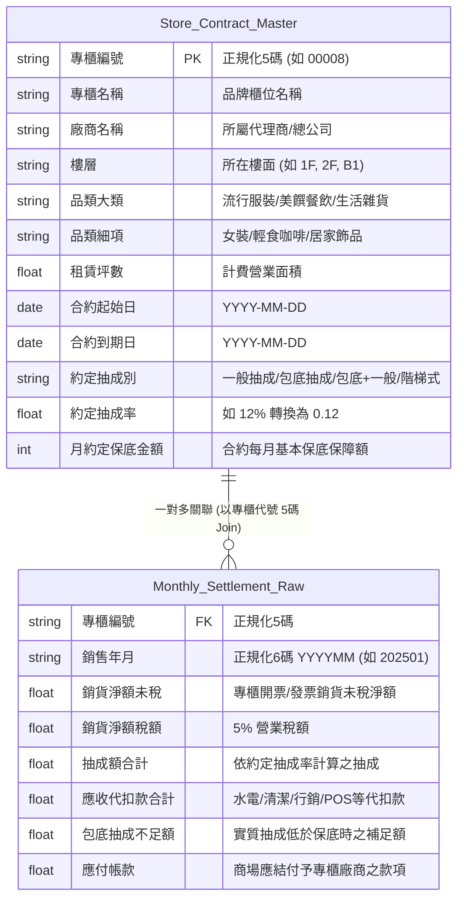

# 商場專櫃營運與招商決策戰情室 (Leasing Hub Dashboard)
## 系統架構深度剖析、核心邏輯審計與新計畫改造白皮書 (v1.0 起點報告)

---

> **報告定位**：本文件為「商場專櫃營運與招商決策戰情室」重構與升級改造工程之第一階段基準文檔（Baseline Audit & Architecture Blueprint）。全面盤點目前已完成之系統組件、資料庫架構、商業邏輯、KPI 計算矩陣、前端互動抽屜，並針對發現之效能瓶頸與架構致命傷提出具體改善計畫。

---

## 目錄
1. [系統整體定位與技術堆疊](#1-系統整體定位與技術堆疊)
2. [資料庫與底層資料架構 (Database Schema)](#2-資料庫與底層資料架構-database-schema)
3. [前端商業邏輯與指標計算引擎 (Core Engine & KPIs)](#3-前端商業邏輯與指標計算引擎-core-engine--kpis)
4. [圖表模組與互動細節 (Modules & Detail Drawer)](#4-圖表模組與互動細節-modules--detail-drawer)
5. [現存致命問題與潛在架構隱患 (Critical Vulnerabilities)](#5-現存致命問題與潛在架構隱患-critical-vulnerabilities)
6. [新計畫改造藍圖與優先級 (Strategic Roadmap)](#6-新計畫改造藍圖與優先級-strategic-roadmap)

---

## 1. 系統整體定位與技術堆疊

本戰情室專為百貨商場、購物中心與 Outlet 之**招商處 (Leasing Department)** 與 **營運處 (Operations Department)** 設計，旨在提供高層主管即時監控專櫃銷貨績效、合約履約狀況、保底抽成平帳、合約到期換約管線，並自動生成招商處置建議。

### 1.1 技術選型與特性
* **前端框架**：原生現代 JavaScript (ES6+) 單頁應用 (SPA)，掛載於 Google Apps Script HtmlService 或獨立靜態部署。
* **樣式與介面**：Tailwind CSS (CDN) + 自訂暗黑終端主題（深海軍藍 `#1E2761` / 卡片 `#212c60` / 邊框 `#36458d`），具備高對比與抗疲勞之數據大屏視覺。
* **視覺化圖表**：Chart.js（橫向條形圖、雙軸折線走勢圖、多維度條形圖）。
* **圖示與資料解析**：Lucide Icons + PapaParse (CSV 串流解析)。
* **後端服務**：Google Apps Script (GAS) 原生微服務（`Code.gs`），整合 Google 官方 `PropertiesService` 加密託管機密屬性。
* **版控與發布管道**：Git 儲存庫（`C:\Github\ReactApp\leasing-dashboard`）+ Google Clasp 雲端雙向推送。

---

## 2. 資料庫與底層資料架構 (Database Schema)

系統採用**主檔 (Master) + 月結流水帳 (Raw)** 的雙表關聯結構，透過專櫃編號 (`Vendor_ID` / `ID`) 進行正規化串聯：



### 2.1 主檔欄位容錯與去重原則
* **欄位別名相容**：透過 `getFieldValue(row, possibleKeys)` 支援「專櫃名稱 / 專櫃 / 品牌名稱 / Name」等多種表單別名。
* **編號標準化 (`normalizeId`)**：無論來源是字串或純數字，一律格式化為 5 碼（如 `8` $\rightarrow$ `00008`），防止前置 0 丟失造成關聯斷裂。
* **多合約去重**：當同一專櫃因歷年續約出現多筆紀錄時，系統以「合約結束日較晚者」為最新有效合約，確保到期日不回溯。

---

## 3. 前端商業邏輯與指標計算引擎 (Core Engine & KPIs)

### 3.1 核心指標 (KPIs) 運算矩陣

| KPI 指標名稱 | 商業定義 | 核心計算公式 | 警戒 / 健康閥值 |
| :--- | :--- | :--- | :--- |
| **區間總銷貨 (GMV)** | 篩選時間區間內商場所有櫃位之未稅總銷售總和 | $\text{GMV} = \sum \text{salesNet}$ | 對比去年同期計算 $\text{YoY}\%$ |
| **同期年增率 (YoY%)** | 衡量相同專櫃相對於去年同一月份之銷售增長 | $\text{YoY} = \frac{\text{GMV}_{\text{curr}} - \text{GMV}_{\text{prior}}}{\text{GMV}_{\text{prior}}}$ | $\le -10\%$ 標註衰退警戒 |
| **商場實質總收益** | 商場真正落袋之收益（常態抽成 + 保底不足補收） | $\text{Revenue} = \sum (\text{commTotal} + \text{minShortage})$ | 商場損益權威數字 |
| **綜合租售比 (OCR%)** | 專櫃租金成本佔其總營收比例（Occupancy Cost Ratio） | $\text{OCR} = \frac{\text{商場實質總收益}}{\text{區間總銷貨}} \times 100\%$ | $\le 18\%$ 健康；$>18\%$ 警戒；$>80\%$ 異常 |
| **平均月坪效** | 衡量單位面積之產能效率（元/坪/月） | $\text{PingSales} = \frac{\text{區間銷貨} \div \text{月份數}}{\text{專櫃坪數}}$ | 供各業種坪效橫向評比 |
| **到期剩餘天數** | 距離合約到期日的日曆天數 | $\text{Days} = \left\lceil \frac{\text{合約到期日} - \text{基準日}}{86,400,000} \right\rceil$ | $-10 \sim 90$ 天進入即時管線 |

### 3.2 收益與平帳防沖銷機制 (Reconciliation Guard)
在傳統 Excel 人工作業中，常見「不足次數」被誤填入「不足金額」欄位（如填寫 `1` 代表不足 1 次，而非補足 1 元）。系統內建平帳偵測機制：
```javascript
// 次數與金額自動校正邏輯
let shortageCount = curr.filter(r => (r.minShortage || 0) > 0).length;
if (minShortageAmount > 0 && minShortageAmount < 50 && realRev > commTotal) {
  shortageCount = minShortageAmount;           // 校正次數
  minShortageAmount = realRev - commTotal;     // 補正真實差額金額
} else if (realRev > commTotal && minShortageAmount === 0) {
  minShortageAmount = realRev - commTotal;
  if (shortageCount === 0) shortageCount = 1;
}
```

### 3.3 自動招商決策處置引擎 (Decision Rules)
系統會依照專櫃的績效表現，自動打上四種智慧標籤：
1. 🔴 **建議汰換 / 調降保底**：
   * 條件：保底不足次數 $\ge 2$ 次，或 YoY 衰退 $\le -10\%$。
   * 方針：評估下修保底門檻或期滿換約替換新品牌。
2. 🟢 **核心續約 / 評估提抽**：
   * 條件：YoY 成長 $\ge +8\%$ 且 OCR $\ge 8\%$。
   * 方針：集客力強、業績亮眼，建議提前鎖定長約，並評估調升抽成率。
3. 🔵 **新進駐 / 籌備中**：
   * 條件：區間銷貨淨額 $\le 0$。
   * 方針：尚無實質銷貨紀錄，重點追蹤進場工期與開業進度。
4. ⚪ **穩定觀察**：
   * 條件：各項指標介於中間值，正常履約監控。

---

## 4. 圖表模組與互動細節 (Modules & Detail Drawer)

系統具備高彈性之互動操作架構：

### 4.1 雙重視角切換 (View Modes)
* **專櫃視角 (STORE)**：以單一專櫃為單位，呈現獨立合約數據與單櫃坪效。
* **廠商/集團視角 (VENDOR)**：自動聚合同一廠商名下之所有專櫃（如某餐飲集團在商場開設 3 家不同品牌餐廳），加總坪數、銷貨、收益，並自動抓取**所屬專櫃最早到期天數**作為集團談判預警指標。

### 4.2 視覺化模組（支援 Chart / Table 一鍵切換）
1. **銷貨 Top 10**：金黃漸層條形圖，顯示銷售冠軍與各專櫃佔總 GMV 比例。
2. **商場收益 Top 10**：青綠漸層條形圖，直觀顯示對商場貢獻最多租金收益的專櫃。
3. **規模與收益全覽**：雙長條橫向圖，快速對比專櫃「銷貨規模」與「商場獲利」是否對等。
4. **OCR% 健康診斷模組**：高於 18% 呈現紅色警示條；具備特殊異常過濾器（0% 或 >80%），避免極端值干擾視覺。
5. **趨勢分析折線圖**：雙 Y 軸走勢圖（左軸銷售額、右軸商場收益），支援「全期 / 3年 / 1年 / 半年」走勢聚焦。
6. **合約到期與續約管線**：
   * 逾期（$<0$ 天）：深紅警示。
   * 緊急（$<10$ 天）：紅色呼吸脈衝動畫 (`animate-pulse`)。
   * 瀕危（$<30$ 天）：橘色徽章。
   * 關注（$<60$ 天）：黃色徽章。
   * 正常（$<90$ 天）：藍色徽章。

### 4.3 360 度專櫃詳情抽屜 (Detail Drawer)
點擊任何專櫃橫列或圖表項目，右側滑出 360 度專櫃專屬看板：
* 顯示合約起訖、抽成模式、保底金額、租賃坪數。
* 拆解財務平帳：銷貨額 $\rightarrow$ 抽成合計 $\rightarrow$ 保底不足次數與補收額 $\rightarrow$ 商場實質總收益。
* 若處於集團模式，動態展開旗下所有專櫃子表格清單。
* 輸出 AI 擬定之「招商談判方針」文字。

---

## 5. 現存致命問題與潛在架構隱患 (Critical Vulnerabilities)

經深入審計原始碼與執行機制，發現以下必須在後續計畫中優先解決的**關鍵缺陷**：

### ⚠️ 致命問題 1：跨年度與新櫃 YoY 年增率計算斷層 (YoY Calculation Flaw)
* **原始邏輯**：
  ```javascript
  priors = periods.map(p => `${parseInt(p.substring(0,4), 10) - 1}${p.substring(4,6)}`);
  ```
* **缺陷**：
  1. 若專櫃為今年新進駐（去年無資料，`priorSales === 0`），計算公式強制回傳 `0`，導致圖表與表格顯示 `+0.0%`，**無法區分「是真的零成長」還是「去年尚未開幕」**。
  2. 若選取區間跨年或歷時不完整，缺少「有效進駐月數」的正規化平準處理。

### ⚠️ 致命問題 2：大數據運算效能瓶頸 (O(N×M) 重複巢狀過濾)
* **原始邏輯**：
  在 `computeDynamicData` 中，針對每一家專櫃（$N$），都對全量月結資料（$M$）執行 `activeMonthlyRaw.filter(...)`。
* **後果**：
  當資料累積至數十個月份、數萬筆月結時，每次點擊時間預設、切換品類或在搜尋框輸入一個字元，前端必須承受數百萬次迴圈比對，會引發明顯介面卡頓（Jank）與記憶體飆升。
* **改善對策**：必須建立以 `storeId_period` 為索引的 Hash Map，將查詢複雜度降至 $O(1)$。

### ⚠️ 致命問題 3：退貨與負值銷貨的平帳邊界缺陷 (Negative Sales & Zero Division)
* **缺陷**：
  百貨專櫃在週年慶退貨或大檔期跨月沖銷時，偶有出現當月銷貨淨額為負數或為 0 的情況。
* **後果**：
  直接進行 `realRev / salesNet` 會產生負數 OCR 或除以 0 的異常（`Infinity` / `NaN`），導致圖表破裂或健康診斷失真。

### ⚠️ 致命問題 4：主管版身分驗證仍仰賴前端點擊暗門 (Security & UX Disconnect)
* **現狀**：目前切換至正式模式仍需在標題「主管版」連續點擊 6 次觸發 `handleSecretUnlock`。
* **隱患**：
  1. 主管在外網使用時體驗不佳且容易遺忘暗門。
  2. 若直接部署為 Web App，應該在使用者打開網頁時，透過後端 `Session.getActiveUser().getEmail()` 自動比對主管授權清單，**全自動進入正式模式**。

### ⚠️ 致命問題 5：缺乏報表導出與列印決策支援 (Export & Actionability)
* 戰情室雖有完整的篩選與標籤引擎，但目前**完全沒有「匯出 Excel / CSV」或「列印週會決策摘要」按鈕**。招商團隊在開會時無法將篩選出的「建議汰換名單」匯出供跨部門討論。

---

## 6. 新計畫改造藍圖與優先級 (Strategic Roadmap)

為打造具備企業級穩定度、高效能與高安全性的戰情室，建議依以下里程碑開展重構工程：

```mermaid
flowchart TD
    subgraph Phase 1: 核心架構加固
        P1_1[建立 Hash Map 索引與效能優化]
        P1_2[修復 YoY 計算斷層與負值除以零防護]
        P1_3[整合 GAS 後端自動身分鑑別]
    end

    subgraph Phase 2: 招商決策功能增強
        P2_1[決策名單一鍵匯出 Excel/CSV]
        P2_2[多合約歷史版本比對與歷年履約率]
        P2_3[樓層坪效與業種分佈熱力圖]
    end

    subgraph Phase 3: 自動化預警與協同
        P3_1[合約到期 60/30 天自動發信通知專員]
        P3_2[招商處置備忘錄與主管審閱簽核]
    end

    Phase 1 --> Phase 2
    Phase 2 --> Phase 3
```

### 優先級推薦實施路徑：
1. **P0（立即實施）**：
   * **效能重構**：將 `computeDynamicData` 改用 Hash Map 索引。
   * **修復計算錯誤**：修正 YoY 新進櫃位呈現（區分「新進駐」與「0% 成長」），加入除以零與負數銷貨防護。
   * **主管身分自動感知**：後端自動檢驗 Google 登入帳號，進入系統即為正式授權模式。
2. **P1（次要實施）**：
   * **決策總表 Excel 匯出功能**：一鍵將當前篩選後的表單（含標籤與談判方針）導出為標準 `.xlsx`。
   * **樓層坪效對比分析**：新增樓面產能對比圖，輔助招商優化樓層櫃位規劃。
3. **P2（長遠實施）**：
   * 整合 Google Gmail API 自動對即將到期的專櫃發送續約意向調查通知。

---
*本報告已正式存檔於專案目錄：[`SYSTEM_AUDIT_AND_ROADMAP.md`](file:///C:/Github/ReactApp/leasing-dashboard/SYSTEM_AUDIT_AND_ROADMAP.md)*
